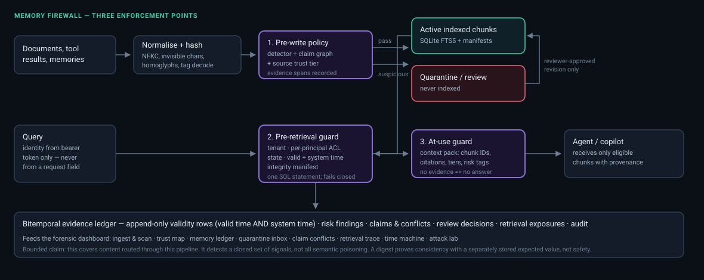

# Architecture



Source: [`architecture.mmd`](architecture.mmd). Re-render with `make arch`.

---

## Shape of the system

```
apps/api/app/main.py          FastAPI — authenticate, bound, sanitise, call the engine, serialise
scripts/serve_dashboard.py    fallback adapter + static server (see DECISIONS D8)
        │
        ▼
packages/memory_firewall/memory_firewall/engine.py
        MemoryFirewallEngine — the single policy authority
        │
        ├── normalize.py    adversarial Unicode normalisation with a reversible offset map
        ├── chunking.py     deterministic boundaries, raw offsets preserved
        ├── detector.py     17 rules + the MF-M001 quotation mitigator
        ├── claims.py       one typed domain; extraction and conflict semantics
        ├── policy.py       decision matrix and the reviewer transition table
        ├── retrieval.py    THE guarded query, fail-closed
        ├── contextpack.py  at-use guard, deterministic cited answer
        ├── integrity.py    manifest side-store
        ├── identity.py     token → principal; privileged-field stripping
        ├── audit.py        append-only event log
        └── db.py           connection per transaction; no cache
```

The API and the SDK are both thin shells over the engine. That is the central structural decision:
one implementation of every security decision, so the two surfaces cannot drift and a test that
proves a property through one proves it for the other.

---

## Data model

| Table | Holds |
|---|---|
| `tenants`, `principals` | identity; `principals.token_sha256` is the only accepted proof |
| `sources`, `source_acl` | administrative trust tier, status, expiry, per-principal read grants |
| `documents`, `document_versions` | content identity: URI, SHA-256, raw and normalised text |
| **`version_validity`** | **append-only** state over time: valid time *and* system time |
| `chunks`, `fts_chunks` | retrieval units and the FTS5 index (manually synchronised) |
| `risk_findings` | rule ID, severity, confidence + semantics, evidence span, detector version |
| `claims`, `conflicts` | the typed domain and evidence-backed disagreements |
| `review_decisions` | approve/reject/revise with actor and reason |
| `retrieval_exposures` | one row per guarded query, including fail-closed ones |
| `snapshots` | pinned (valid time, recorded time) coordinates for replay |
| `audit_events` | who did what, when, with the before/after state |

**Why validity is a separate table.** Content identity and state-over-time are different things with
different lifetimes. Keeping them apart is what makes an append-only history possible: a state change
closes the current row in system time and inserts a new one, so a query at a past recorded time still
sees what was believed then. A `status` column on the version could not answer that question.

---

## Request paths

### Ingest

```
authenticate → strip privileged fields → bound size
  → normalise (invisible removal, confusable folding, tag decoding; offset map retained)
  → chunk (deterministic; raw offsets preserved)
  → per chunk: detect → extract claims → compare against standing claims → decide
  → ONE transaction: version + validity row + chunks + FTS rows + findings + claims + conflicts + audit
  → manifests written after commit (a missing manifest fails closed, so the ordering is safe)
```

### Retrieve

```
authenticate → strip privileged fields
  → ONE SQL statement: FTS5 MATCH ∧ tenant ∧ source status/expiry ∧ ACL ∧ document status
                       ∧ chunk state ∧ version state ∧ valid-time window ∧ system-time window
  → trust floor            (can only remove)
  → integrity recheck      (can only remove; missing manifest fails closed)
  → provenance tagging     (weak tier ⇒ treat-as-data tag, regardless of findings)
  → exposure row written   (including on fail-closed)
  → admin-only trace, tenant-scoped, including withheld chunks the index cannot show
```

Any exception at any point: empty result, `fail_closed: true`, `guard_enforced: true`.

---

## Defence in depth, and how it is proven

Quarantined chunks are not written to the FTS index **and** the SQL gate independently excludes
non-active states. Either layer alone would block poison, which makes it easy to ship a system where
only one actually works.

So `memory_firewall.testing` forces poison into the live index with the write guard entirely
bypassed, in **ten modes**, each breaking exactly one predicate:

| Mode | Predicate it defeats |
|---|---|
| `quarantined_chunk_indexed` | `chunks.state` |
| `revoked_source_active_chunk` | `sources.status` |
| `expired_source` | `sources.expires_at` |
| `tombstoned_document` | `documents.status` |
| `superseded_version` | `version_validity.state` |
| `expired_version` | valid-time window |
| `future_recorded_time` | system-time window |
| `no_acl_active_chunk` | `source_acl` join |
| `digest_mismatch` | integrity recheck |
| `missing_manifest` | integrity recheck, absent expected value |

Plus an orphan FTS row with no backing chunk. All eleven are excluded, every time, by the second
gate alone. A single missing check cannot pass this suite.

---

## Dashboard

TypeScript compiled to native ES modules; no framework, no bundler, no runtime dependencies
(DECISIONS D7). Eight panes over a typed API client:

**Ingest & scan** · **Source trust map** · **Quarantine inbox** · **Claim conflicts** ·
**Retrieval trace** · **Memory ledger** · **Time machine** · **Attack lab**

Two security properties hold in the UI itself: no code path assigns `innerHTML` — untrusted text
always becomes a text node, and evidence highlights are rebuilt from finding offsets with real
`<mark>` elements — and the server sends `default-src 'none'; script-src 'self'; style-src 'self'`.
The CSP is strict enough that it blocked Playwright's own `wait_for_function` during E2E
development, and strict enough to catch three inline `style` attributes that were being silently
dropped.

---

## Ports

| | |
|---|---|
| API | `127.0.0.1:8002` (`MF_API_PORT`) |
| Dashboard | `127.0.0.1:5174` (`MF_WEB_PORT`) |
| Database | `data/memory-firewall.sqlite3` (`MF_DB_PATH`) |
| Manifests | `data/memory-firewall.sqlite3.manifests` — **a separate file, on purpose** |
